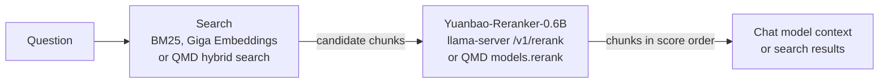

# Yuanbao-Reranker-0.6B GGUF: Q8_0 and Q4_K_M reranker for Russian search in QMD and llama.cpp

[Русская версия](README.ru.md) ·
[Hugging Face](https://huggingface.co/ai-babai/Yuanbao-Reranker-0.6B-GGUF) ·
[QMD](docs/qmd.md) ·
[Open WebUI + Giga Embeddings](docs/open-webui.md) ·
[Build from source](docs/conversion.md) ·
[RuBQ results](results/rubq-pilot.md) ·
[Languages and runtimes](#languages-and-runtimes) ·
[Original model](https://huggingface.co/Yuanbao-Search/Yuanbao-Reranker-0.6B/tree/0101299a7937a016848d8d55b092f6e31cfa312d)

A local reranker for Russian-language search and RAG. This repository converts
Tencent's multilingual Yuanbao-Reranker-0.6B to GGUF with rank pooling and an embedded
ranking prompt. Stock `llama-server --reranking` serves it at `/v1/rerank`, and
QMD loads it through `models.rerank`. The checks ran on Apple Silicon with Metal
and on CPU.

**Start with Q8_0.** It is the file tested in QMD and Open WebUI. On 150
Russian RuBQ questions it scored 0.8480 nDCG@10, against 0.8124 for the
Qwen3-Reranker-0.6B Q8_0 that QMD uses by default, on the same llama.cpp build.

This is an independent ai-babai conversion, not an official Tencent release.

## Where the reranker fits



1. A fast search selects candidates: BM25, vector search with an embedding
   model such as Giga Embeddings, or QMD's hybrid search.
2. Yuanbao reads the question with each candidate and returns a relevance score
   from 0 to 1.
3. The highest-scoring chunks go to the chat model as context or become the
   search results.

The reranker does not search on its own. It reorders what the first stage found.

## Languages and runtimes

**Languages.** Tencent lists Chinese and English and describes the source model as multilingual. Its MLDR evaluation includes Arabic, Chinese, English, French, German, Hindi, Italian, Japanese, Korean, Portuguese, Russian, Spanish and Thai. The published MLDR number is an average across those 13 languages. We benchmarked these GGUFs on Russian RuBQ. In a separate CPU check, Q8_0 put the expected passage first on two hand-written queries each in English, Chinese and Russian. [Six requests and their scores](results/language-smoke.json) ·
[Tencent model card](https://huggingface.co/Yuanbao-Search/Yuanbao-Reranker-0.6B/blob/0101299a7937a016848d8d55b092f6e31cfa312d/README.md) ·
[Tencent benchmark task list](https://github.com/Yuanbao-Search/Yuanbao-Reranker/blob/3931311f46d3a815ad07b932d4796e54f77ff433/src/yuanbao_reranker/benchmarks.json)

| Runtime | Status with these GGUF files |
| --- | --- |
| llama.cpp `llama-server`, `/v1/rerank` | Tested at commit `5fddd0b` on Apple Metal and CPU. |
| node-llama-cpp 3.22.3 inside QMD 2.9.0 | Tested on Apple Metal, SDK and CLI. |
| Open WebUI 0.13.4, External reranker | Tested through llama-server on CPU. |
| LM Studio 0.4.25 (build 1) | Imports and loads Q8_0 as an LLM. The app API returned no ranking scores. The separate llama-server executable bundled in runtimes 2.44.0 and 2.82.0 ranked documents correctly. [Test and launch command](docs/lm-studio.md) |
| Transformers, vLLM, `yuanbao-reranker` package | Documented by Tencent for the original safetensors weights, not for GGUF. |

## Choose a file

| File | Size | Use it for |
| --- | ---: | --- |
| `Yuanbao-Reranker-0.6B-Q8_0.gguf` | 0.64 GB | Default. Tested in QMD 2.9.0 and Open WebUI 0.13.4. |
| `Yuanbao-Reranker-0.6B-Q4_K_M.gguf` | 0.40 GB | 38% smaller than Q8_0 with similar RuBQ scores. The top passage changed on 10 of 150 questions. Not tested in QMD or Open WebUI. |
| `Yuanbao-Reranker-0.6B-F16.gguf` | 1.20 GB | Checking a conversion or comparing quantizations. |

On 12 RuBQ pairs, the mean absolute difference from BF16 probabilities was
0.00385 for Q8_0 and 0.02555 for Q4_K_M. The largest single difference was
0.021 for Q8_0 and 0.150 for Q4_K_M.
[Score verification](docs/conversion.md#score-verification)

## Run a local `/v1/rerank` server

This GitHub repository and the Hugging Face model repository are private for
now. Downloading needs an account with access. Use the
[tested llama.cpp build](docs/conversion.md) and put its `build/bin` directory
on your `PATH`.

```sh
gh release download v0.1.0 --repo ai-babai/yuanbao-reranker-gguf \
  --pattern 'Yuanbao-Reranker-0.6B-Q8_0.gguf' --pattern SHA256SUMS --dir ./models
(cd models && grep 'Q8_0.gguf' SHA256SUMS | shasum -a 256 -c -)
llama-server -m ./models/Yuanbao-Reranker-0.6B-Q8_0.gguf \
  --reranking --alias yuanbao --host 127.0.0.1 --port 8091
```

The same files are on Hugging Face:

```sh
hf download ai-babai/Yuanbao-Reranker-0.6B-GGUF \
  Yuanbao-Reranker-0.6B-Q8_0.gguf SHA256SUMS \
  --revision v0.1.0 --local-dir ./models
```

```sh
curl -sS http://127.0.0.1:8091/v1/rerank \
  -H 'Content-Type: application/json' \
  -d '{"model":"yuanbao","query":"Как отключить автопродление подписки?","documents":["Для изменения пароля откройте настройки безопасности.","Откройте раздел подписок и выключите автоматическое продление."],"top_n":2}'
```

The server returns the original document indices with their scores, highest
first. On Apple M4 Pro this request put the subscription passage (index 1) first
with a relevance score of 0.94275. The password passage (index 0) scored
0.00046. With the same documents and the question «Где поменять пароль?», the
password passage moved to first place.

For CPU-only serving, the [Open WebUI guide](docs/open-webui.md#start-the-reranker)
lists the flags used in its check.

## Use it in QMD

QMD indexes folders of Markdown files, such as notes or an Obsidian vault. Its
default reranker is Qwen3-Reranker-0.6B. To use Yuanbao, point `models.rerank`
in the index configuration to the downloaded file with an absolute path:

```yaml
models:
  rerank: "/absolute/path/to/Yuanbao-Reranker-0.6B-Q8_0.gguf"
```

Run `qmd trust` to approve the custom model, then `qmd update` and `qmd embed`.
QMD 2.9.0 created rank-pooling contexts for this file and reranked Russian
queries on Metal. The guide also covers typed queries, how QMD blends the
reranker score with retrieval order, and the rerank cache when you change the
model. We tested QMD itself, not an Obsidian plugin.
[QMD guide](docs/qmd.md)

## Use it in Open WebUI

In **Admin Panel → Settings → Documents**, enable **Hybrid Search**, choose
**External** as the reranking engine and enter the full URL
`http://127.0.0.1:18122/v1/rerank`. Open WebUI's BM25 and dense search select
the candidates, Yuanbao reorders them, and the top chunks go to the chat. The
guide pairs it with Giga Embeddings served by a second llama-server.
[Open WebUI guide](docs/open-webui.md)

## Russian quality on RuBQ

The pilot uses 150 public RuBQ questions and 3,656 question–passage pairs,
following the Horizon Labs protocol. Each GGUF ran on the same llama.cpp build
through the stock `/v1/rerank` endpoint with the same 512-token input policy.
Higher is better.

| Model | nDCG@10 | MRR@10 | Same top passage as F16 |
| --- | ---: | ---: | ---: |
| Yuanbao-Reranker-0.6B Q8_0 | 0.8480 | 0.8408 | 150 of 150 |
| Yuanbao-Reranker-0.6B Q4_K_M | 0.8488 | 0.8391 | 140 of 150 |
| Yuanbao-Reranker-0.6B F16 | 0.8476 | 0.8408 | baseline |
| Qwen3-Reranker-0.6B Q8_0, ggml-org, QMD default | 0.8124 | 0.7949 | — |

The original BF16 weights in PyTorch scored 0.8488 and 0.8419 on the same
questions. The three Yuanbao files differ by at most 0.0012 nDCG@10. Q4_K_M changes which
passage comes first more often, so Q8_0 stays the default.
Against the Qwen3 Q8_0, Yuanbao Q8_0 gained +0.0355 nDCG@10, with a paired
bootstrap 95% interval of +0.0184 to +0.0536.
Horizon Labs published 0.8608 nDCG@10 for BGE-Reranker-v2-m3 on this sample,
measured on CUDA with the original weights.
[Full results: ties, score agreement, latency and memory](results/rubq-pilot.md) ·
[Reproduce the benchmark](benchmark/README.md) ·
[Horizon baselines](https://huggingface.co/Horizon-Labs/multilingual-reranker-base/resolve/7330f6d0b3f560af0c2b9a63820ea299a45fd91b/eval/baselines.json)

## Before you rely on the scores

- The ranking prompt is fixed in the GGUF. It uses the English web-search
  instruction from the evaluation, and `/v1/rerank` does not change it per
  request.
- Use the score to order candidates for one question. We did not test fixed
  score thresholds.
- The evaluation limits each question–passage input to 512 tokens. Longer
  passages can rank differently. See the
  [input notes](docs/conversion.md#classifier-and-prompt).
- Tencent's model accepts a custom instruction and up to 8,192 tokens. These
  GGUF results cover the fixed instruction and 512-token inputs.

## Reproduce

Recreate the evaluation sample outside this checkout. The script checks that the
dataset revision, seed, candidate order and 2,000-character document limit match
the reference run.

```sh
uv run --script scripts/prepare_rubq.py /path/to/bench/rubq.parquet
```

The published Horizon comparison uses a 512-token total input budget and single
newlines between instruction, query and passage. Tencent's example uses blank
lines and a longer context. Run all GGUFs with the same input policy for a
quality comparison.
[Horizon evaluation code](https://huggingface.co/Horizon-Labs/multilingual-reranker-base/tree/7330f6d0b3f560af0c2b9a63820ea299a45fd91b/code/rerank) ·
[RuBQ dataset, CC BY-SA 4.0](https://huggingface.co/datasets/mteb/RuBQReranking/tree/f2eac2f1f82445938af650c2a285a34dd77a16eb)

- [Build the three GGUFs from the pinned checkpoint](docs/conversion.md)
- [Run the llama.cpp benchmark and latency measurements](benchmark/README.md)

## License and attribution

Independent ai-babai conversion of the
[Tencent Yuanbao Search checkpoint](https://huggingface.co/Yuanbao-Search/Yuanbao-Reranker-0.6B/tree/0101299a7937a016848d8d55b092f6e31cfa312d),
derived from Qwen3 and released under Apache-2.0. Modifications consist of the
reranking GGUF conversion, prompt configuration and quantization. See
[LICENSE](LICENSE) and [NOTICE](NOTICE). The comparison uses the
[ggml-org Qwen3-Reranker-0.6B-Q8_0 GGUF](https://huggingface.co/ggml-org/Qwen3-Reranker-0.6B-Q8_0-GGUF/tree/a02f48bb4f057028298c21fa033da2b30d7742d5).
RuBQ labels are under CC BY-SA 4.0.
