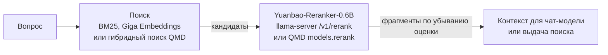

# Yuanbao-Reranker-0.6B GGUF: многоязычный реранкер для llama.cpp и QMD (Q8_0, Q4_K_M)

[English](README.md) ·
[Hugging Face](https://huggingface.co/ai-babai/Yuanbao-Reranker-0.6B-GGUF) ·
[Быстрый старт](#быстрый-старт) ·
[Результаты RuBQ](results/rubq-pilot.md) ·
[Языки и движки](#языки-и-движки) ·
[QMD](docs/qmd.md) ·
[Open WebUI + Giga Embeddings](docs/open-webui.md) ·
[Для агентов](AGENTS.md)


Tencent дообучила Qwen3-0.6B для многоязычного поиска и RAG. В формате GGUF Yuanbao можно запускать локально для поиска по текстам на английском, китайском, русском и других языках. Мы проверили запуск в llama.cpp на Metal и CPU, интеграцию с QMD на Metal и качество ранжирования на русском бенчмарке RuBQ. [Статья Tencent](https://arxiv.org/abs/2611.10405)

## Какой файл выбрать

**Начинайте с Q8_0.** Этот файл проверен в QMD и Open WebUI и сохранил первый
фрагмент F16 во всех 150 вопросах RuBQ.

| Файл | Размер | Для чего |
| --- | ---: | --- |
| `Yuanbao-Reranker-0.6B-Q8_0.gguf` | 0,64 ГБ | Основной. Проверен в QMD 2.9.0 и Open WebUI 0.13.4. |
| `Yuanbao-Reranker-0.6B-Q4_K_M.gguf` | 0,40 ГБ | На 38% меньше Q8_0 при близких оценках на RuBQ. Первый фрагмент сменился в 10 вопросах из 150. В QMD и Open WebUI не проверялся. |
| `Yuanbao-Reranker-0.6B-F16.gguf` | 1,20 ГБ | Проверка конвертации и сравнение квантов. |

## Быстрый старт

Аккаунт не нужен. Скачайте Q8_0 и контрольную сумму с Hugging Face и запустите
сервер; [проверенная сборка llama.cpp](docs/conversion.md) должна быть в `PATH`.

```sh
base=https://huggingface.co/ai-babai/Yuanbao-Reranker-0.6B-GGUF/resolve/v0.1.1
mkdir -p models
curl -fL -o models/Yuanbao-Reranker-0.6B-Q8_0.gguf "$base/Yuanbao-Reranker-0.6B-Q8_0.gguf"
curl -fL -o models/SHA256SUMS "$base/SHA256SUMS"
(cd models && grep 'Q8_0.gguf' SHA256SUMS | shasum -a 256 -c -)
llama-server -m models/Yuanbao-Reranker-0.6B-Q8_0.gguf \
  --reranking --alias yuanbao --host 127.0.0.1 --port 8091
```

```sh
curl -sS http://127.0.0.1:8091/v1/rerank \
  -H 'Content-Type: application/json' \
  -d '{"model":"yuanbao","query":"Как отключить автопродление подписки?","documents":["Для изменения пароля откройте настройки безопасности.","Откройте раздел подписок и выключите автоматическое продление."],"top_n":2}'
```

Сервер возвращает исходные номера документов с оценками, лучший первым. На
Apple M4 Pro этот запрос поставил первым абзац о подписке (индекс 1) с оценкой
0,94275. Абзац о пароле (индекс 0) получил 0,00046. С теми же документами на
вопрос «Где поменять пароль?» первым стал абзац о пароле. Флаги для работы
только на CPU — в [руководстве по Open WebUI](docs/open-webui.md#start-the-reranker).

Те же файлы через Hugging Face CLI или, если `gh` авторизован, из релиза GitHub:

```sh
hf download ai-babai/Yuanbao-Reranker-0.6B-GGUF \
  Yuanbao-Reranker-0.6B-Q8_0.gguf SHA256SUMS --revision v0.1.1 --local-dir ./models
gh release download v0.1.1 --repo ai-babai/yuanbao-reranker-gguf \
  --pattern 'Yuanbao-Reranker-0.6B-Q8_0.gguf' --pattern SHA256SUMS --dir ./models
```

**Для агентов и скриптов:** в [manifest.json](manifest.json) — ревизия
релиза, имена файлов, размеры и SHA-256.
[results/rubq-pilot.json](results/rubq-pilot.json) — результаты
бенчмарка, [AGENTS.md](AGENTS.md) — какие файлы читать под задачу.

## Качество на русском: RuBQ

Пилот — 150 открытых вопросов RuBQ и 3 656 пар «вопрос — фрагмент» по протоколу
Horizon Labs. Все GGUF запускались на одной сборке llama.cpp через штатный
`/v1/rerank` с одинаковым ограничением входа в 512 токенов. Больше — лучше.

| Модель | nDCG@10 | MRR@10 | Тот же первый фрагмент, что у F16 |
| --- | ---: | ---: | ---: |
| Yuanbao-Reranker-0.6B Q8_0 | 0,8480 | 0,8408 | 150 из 150 |
| Yuanbao-Reranker-0.6B Q4_K_M | 0,8488 | 0,8391 | 140 из 150 |
| Yuanbao-Reranker-0.6B F16 | 0,8476 | 0,8408 | база |
| Qwen3-Reranker-0.6B Q8_0, ggml-org, по умолчанию в QMD | 0,8124 | 0,7949 | — |

Исходные веса BF16 в PyTorch на тех же вопросах дали 0,8488 и 0,8419.
Три файла Yuanbao расходятся не больше чем на 0,0012 nDCG@10. Q4_K_M чаще
меняет первый фрагмент, поэтому основным остаётся Q8_0.
По сравнению с Qwen3-Reranker-0.6B Q8_0 у Yuanbao Q8_0 nDCG@10 выше на 0,0355, парный
бутстреп даёт 95-процентный интервал от +0,0184 до +0,0536. Horizon Labs
опубликовали для BGE-Reranker-v2-m3 на этой выборке 0,8608 nDCG@10; это
исходные веса на CUDA.
[Полные результаты: равные оценки, согласие оценок, задержка и память, англ.](results/rubq-pilot.md) ·
[Как воспроизвести, англ.](benchmark/README.md) ·
[Результаты Horizon](https://huggingface.co/Horizon-Labs/multilingual-reranker-base/resolve/7330f6d0b3f560af0c2b9a63820ea299a45fd91b/eval/baselines.json)

На 12 парах из RuBQ средняя абсолютная разница с вероятностями BF16 составила
0,00385 у Q8_0 и 0,02555 у Q4_K_M. Наибольшая разница на одной паре — 0,021 у
Q8_0 и 0,150 у Q4_K_M.
[Проверка оценок](docs/conversion.md#score-verification)

## Где работает реранкер



1. Быстрый поиск отбирает кандидатов: BM25, векторный поиск с эмбеддером
   вроде Giga Embeddings или гибридный поиск QMD.
2. Yuanbao читает вопрос вместе с каждым кандидатом и ставит оценку
   релевантности от 0 до 1.
3. Фрагменты с лучшими оценками уходят чат-модели как контекст или становятся
   результатами поиска.

Сам реранкер не ищет. Он переставляет то, что нашёл первый этап.

**Linux без GPU.** На трёх vCPU AMD EPYC 7763 медиана для 10 фрагментов составила 11,71 с с Q4_K_M и 14,18 с с Q8_0. [Замеры для 10, 25 и 50 фрагментов](results/linux-cpu.md) · [Исходные измерения](results/linux-cpu.json)

## Языки и движки

**Языки.** Tencent указывает китайский и английский и называет исходную модель многоязычной. В MLDR авторы оценивали арабский, китайский, английский, французский, немецкий, хинди, итальянский, японский, корейский, португальский, русский, испанский и тайский. Опубликованная оценка усреднена по этим 13 языкам. Мы измерили качество GGUF на русском RuBQ. В отдельной проверке на CPU Q8_0 поставил нужный фрагмент первым на двух составленных вручную вопросах на каждом из трёх языков — английском, китайском и русском. [Шесть запросов и ответы сервера](results/language-smoke.json) ·
[Карточка Tencent](https://huggingface.co/Yuanbao-Search/Yuanbao-Reranker-0.6B/blob/0101299a7937a016848d8d55b092f6e31cfa312d/README.md) ·
[Список задач оценки Tencent](https://github.com/Yuanbao-Search/Yuanbao-Reranker/blob/3931311f46d3a815ad07b932d4796e54f77ff433/src/yuanbao_reranker/benchmarks.json)

| Движок | Статус для этих GGUF |
| --- | --- |
| llama.cpp `llama-server`, `/v1/rerank` | Проверен на коммите `5fddd0b` с Apple Metal и на CPU. |
| node-llama-cpp 3.22.3 внутри QMD 2.9.0 | Проверен на Apple Metal, через SDK и CLI. |
| Open WebUI 0.13.4, внешний реранкер | Проверен через llama-server на CPU. |
| LM Studio 0.4.25 (build 1) | Импортирует и загружает Q8_0 как LLM. API приложения не вернул оценки. Отдельный llama-server из комплектов runtime 2.44.0 и 2.82.0 успешно ранжировал документы. [Проверка и команда запуска](docs/lm-studio.md) |
| Transformers, vLLM, пакет `yuanbao-reranker` | Tencent описывает их для исходных весов safetensors, не для GGUF. |

## QMD

QMD индексирует папки с Markdown-файлами, например заметки или хранилище
Obsidian. По умолчанию QMD использует реранкер Qwen3-Reranker-0.6B. Чтобы
подключить Yuanbao, укажите в конфигурации индекса абсолютный путь к скачанному
файлу в `models.rerank`:

```yaml
models:
  rerank: "/absolute/path/to/Yuanbao-Reranker-0.6B-Q8_0.gguf"
```

Затем выполните `qmd trust`, чтобы одобрить свою модель, и `qmd update` с
`qmd embed`. QMD 2.9.0 создал для этого файла контексты с rank pooling и
переранжировал русские запросы на Metal. В руководстве разобраны типизированные
запросы, смешивание оценки реранкера с порядком поиска и кеш оценок при смене
модели. Проверяли сам QMD, а не плагин для Obsidian.
[Руководство по QMD, англ.](docs/qmd.md)

## Open WebUI

В **Admin Panel → Settings → Documents** включите **Hybrid Search**, выберите
**External** как движок ранжирования и укажите полный URL
`http://127.0.0.1:18122/v1/rerank`. BM25 и векторный поиск Open WebUI отбирают
кандидатов, Yuanbao их переставляет, лучшие фрагменты уходят в чат. В
руководстве к нему добавлен Giga Embeddings на втором llama-server.
[Руководство по Open WebUI, англ.](docs/open-webui.md)

## Что учесть перед использованием

- Во всех запросах используется одна встроенная английская инструкция
  «Given a web search query, retrieve relevant passages that answer the query»:
  вопрос и документы могут быть на русском, английском, китайском и других
  языках, но заменить инструкцию под свою задачу через `/v1/rerank` нельзя.
- Оценка нужна, чтобы упорядочить кандидатов для одного вопроса. Фиксированные
  пороги оценки мы не проверяли.
- В оценке каждая пара «вопрос — фрагмент» ограничена 512 токенами. Более
  длинные фрагменты могут ранжироваться иначе.
  [Подробности о входе](docs/conversion.md#classifier-and-prompt)
- Исходная модель Tencent принимает свою инструкцию и до 8 192 токенов.
  Результаты для GGUF получены с зашитой инструкцией и входом до 512 токенов.

## Воспроизведение

Выборку для оценки соберите вне этого репозитория. Скрипт проверяет, что версия
датасета, seed, порядок кандидатов и ограничение документа в 2 000 символов
совпадают с эталонным прогоном.

```sh
uv run --script scripts/prepare_rubq.py /path/to/bench/rubq.parquet
```

Опубликованное сравнение Horizon ограничивает вход 512 токенами и разделяет
инструкцию, вопрос и фрагмент одиночным переводом строки. В примере Tencent
поля разделены пустой строкой, а контекст длиннее. Для сравнения качества
запускайте все GGUF с одинаковыми правилами входа.
[Код оценки Horizon](https://huggingface.co/Horizon-Labs/multilingual-reranker-base/tree/7330f6d0b3f560af0c2b9a63820ea299a45fd91b/code/rerank) ·
[Датасет RuBQ, CC BY-SA 4.0](https://huggingface.co/datasets/mteb/RuBQReranking/tree/f2eac2f1f82445938af650c2a285a34dd77a16eb)

- [Собрать три GGUF из закреплённого checkpoint, англ.](docs/conversion.md)
- [Запустить бенчмарк llama.cpp и замеры задержки, англ.](benchmark/README.md)

Обе проверенные вместе модели собраны в [коллекции для русского поиска в Open WebUI](https://huggingface.co/collections/ai-babai/russian-rag-on-llamacpp-giga-embeddings-yuanbao-reranker-6b05c0c5c56ce9ebf2396add).

## Лицензия и авторство

Независимая конвертация ai-babai
[checkpoint Tencent Yuanbao Search](https://huggingface.co/Yuanbao-Search/Yuanbao-Reranker-0.6B/tree/0101299a7937a016848d8d55b092f6e31cfa312d),
дообученного Tencent из Qwen3-0.6B, под лицензией Apache-2.0. Изменения: конвертация в GGUF
для ранжирования, настройка промпта и квантование. См. [LICENSE](LICENSE) и
[NOTICE](NOTICE). Для сравнения использован
[GGUF ggml-org Qwen3-Reranker-0.6B-Q8_0](https://huggingface.co/ggml-org/Qwen3-Reranker-0.6B-Q8_0-GGUF/tree/a02f48bb4f057028298c21fa033da2b30d7742d5).
Метки RuBQ распространяются по CC BY-SA 4.0.

**Автор порта GGUF, квантования, интеграций и бенчмарков — Максим Попков** (Maksim Popkov, ai-babai). [Как сослаться на порт](https://github.com/ai-babai/yuanbao-reranker-gguf/blob/main/CITATION.cff)
