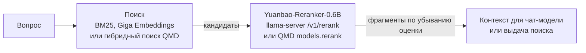

# Yuanbao-Reranker-0.6B GGUF: реранкер для русского языка в QMD и llama.cpp

[English](README.md) ·
[Hugging Face](https://huggingface.co/ai-babai/Yuanbao-Reranker-0.6B-GGUF) ·
[QMD](docs/qmd.md) ·
[Open WebUI + Giga Embeddings](docs/open-webui.md) ·
[Сборка из исходников](docs/conversion.md) ·
[Результаты RuBQ](results/rubq-pilot.md) ·
[Исходная модель](https://huggingface.co/Yuanbao-Search/Yuanbao-Reranker-0.6B/tree/0101299a7937a016848d8d55b092f6e31cfa312d)

Локальный реранкер для поиска по русским текстам и RAG. Здесь лежит
Yuanbao-Reranker-0.6B от Tencent, переведённый в GGUF с rank pooling и
встроенным промптом ранжирования. Штатный `llama-server --reranking` отдаёт его
через `/v1/rerank`, а QMD подключает через `models.rerank`. Проверено на Apple
Silicon с Metal и на CPU.

**Начинайте с Q8_0.** Именно этот файл проверен в QMD и Open WebUI. На 150
русских вопросах RuBQ он набрал 0,8480 nDCG@10. Qwen3-Reranker-0.6B Q8_0,
который QMD использует по умолчанию, на той же сборке llama.cpp набрал 0,8124.

Это независимая конвертация ai-babai, а не официальный релиз Tencent.

## Где работает реранкер



1. Быстрый поиск отбирает кандидатов: BM25, векторный поиск с эмбеддером
   вроде Giga Embeddings или гибридный поиск QMD.
2. Yuanbao читает вопрос вместе с каждым кандидатом и ставит оценку
   релевантности от 0 до 1.
3. Фрагменты с лучшими оценками уходят чат-модели как контекст или становятся
   результатами поиска.

Сам реранкер не ищет. Он переставляет то, что нашёл первый этап.

## Какой файл выбрать

| Файл | Размер | Для чего |
| --- | ---: | --- |
| `Yuanbao-Reranker-0.6B-Q8_0.gguf` | 0,64 ГБ | Основной. Проверен в QMD 2.9.0 и Open WebUI 0.13.4. |
| `Yuanbao-Reranker-0.6B-Q4_K_M.gguf` | 0,40 ГБ | На 38% меньше Q8_0 при близких оценках на RuBQ. Первый фрагмент сменился в 10 вопросах из 150. В QMD и Open WebUI не проверялся. |
| `Yuanbao-Reranker-0.6B-F16.gguf` | 1,20 ГБ | Проверка конвертации и сравнение квантов. |

На 12 парах из RuBQ средняя абсолютная разница с вероятностями BF16 составила
0,00385 у Q8_0 и 0,02555 у Q4_K_M. Наибольшая разница на одной паре — 0,021 у
Q8_0 и 0,150 у Q4_K_M.
[Проверка оценок](docs/conversion.md#score-verification)

## Локальный сервер `/v1/rerank`

Репозиторий на GitHub и модель на Hugging Face пока приватные. Для скачивания
нужен аккаунт с доступом. Используйте
[проверенную сборку llama.cpp](docs/conversion.md) и добавьте её каталог
`build/bin` в `PATH`.

```sh
gh release download v0.1.0 --repo ai-babai/yuanbao-reranker-gguf \
  --pattern 'Yuanbao-Reranker-0.6B-Q8_0.gguf' --pattern SHA256SUMS --dir ./models
(cd models && grep 'Q8_0.gguf' SHA256SUMS | shasum -a 256 -c -)
llama-server -m ./models/Yuanbao-Reranker-0.6B-Q8_0.gguf \
  --reranking --alias yuanbao --host 127.0.0.1 --port 8091
```

Те же файлы лежат на Hugging Face:

```sh
hf download ai-babai/Yuanbao-Reranker-0.6B-GGUF \
  Yuanbao-Reranker-0.6B-Q8_0.gguf SHA256SUMS \
  --revision v0.1.0 --local-dir ./models
```

```sh
curl -sS http://127.0.0.1:8091/v1/rerank \
  -H 'Content-Type: application/json' \
  -d '{"model":"yuanbao","query":"Как отключить автопродление подписки?","documents":["Для изменения пароля откройте настройки безопасности.","Откройте раздел подписок и выключите автоматическое продление."],"top_n":2}'
```

Сервер возвращает исходные номера документов с оценками, лучший первым. На
Apple M4 Pro этот запрос поставил первым абзац о подписке (индекс 1) с оценкой
0,94275. Абзац о пароле (индекс 0) получил 0,00046. С теми же документами на
вопрос «Где поменять пароль?» первым стал абзац о пароле.

Флаги для работы только на CPU приведены в
[руководстве по Open WebUI](docs/open-webui.md#start-the-reranker).

## QMD

QMD индексирует папки с Markdown-файлами, например заметки или хранилище
Obsidian. По умолчанию QMD использует реранкер Qwen3-Reranker-0.6B. Чтобы
подключить Yuanbao, укажите в конфигурации индекса абсолютный путь к скачанному
файлу в `models.rerank`:

```yaml
models:
  rerank: "/absolute/path/to/Yuanbao-Reranker-0.6B-Q8_0.gguf"
```

Затем выполните `qmd trust`, чтобы одобрить свою модель, и `qmd update` с
`qmd embed`. QMD 2.9.0 создал для этого файла контексты с rank pooling и
переранжировал русские запросы на Metal. В руководстве разобраны типизированные
запросы, смешивание оценки реранкера с порядком поиска и кеш оценок при смене
модели. Проверяли сам QMD, а не плагин для Obsidian.
[Руководство по QMD, англ.](docs/qmd.md)

## Open WebUI

В **Admin Panel → Settings → Documents** включите **Hybrid Search**, выберите
**External** как движок ранжирования и укажите полный URL
`http://127.0.0.1:18122/v1/rerank`. BM25 и векторный поиск Open WebUI отбирают
кандидатов, Yuanbao их переставляет, лучшие фрагменты уходят в чат. В
руководстве к нему добавлен Giga Embeddings на втором llama-server.
[Руководство по Open WebUI, англ.](docs/open-webui.md)

## Качество на русском: RuBQ

Пилот — 150 открытых вопросов RuBQ и 3 656 пар «вопрос — фрагмент» по протоколу
Horizon Labs. Все GGUF запускались на одной сборке llama.cpp через штатный
`/v1/rerank` с одинаковым ограничением входа в 512 токенов. Больше — лучше.

| Модель | nDCG@10 | MRR@10 | Тот же первый фрагмент, что у F16 |
| --- | ---: | ---: | ---: |
| Yuanbao-Reranker-0.6B Q8_0 | 0,8480 | 0,8408 | 150 из 150 |
| Yuanbao-Reranker-0.6B Q4_K_M | 0,8488 | 0,8391 | 140 из 150 |
| Yuanbao-Reranker-0.6B F16 | 0,8476 | 0,8408 | база |
| Qwen3-Reranker-0.6B Q8_0, ggml-org, по умолчанию в QMD | 0,8124 | 0,7949 | — |

Исходные веса BF16 в PyTorch на тех же вопросах дали 0,8488 и 0,8419.
Три файла Yuanbao расходятся не больше чем на 0,0012 nDCG@10. Q4_K_M чаще
меняет первый фрагмент, поэтому основным остаётся Q8_0. Horizon Labs
опубликовали для BGE-Reranker-v2-m3 на этой выборке 0,8608 nDCG@10; это
исходные веса на CUDA.
[Полные результаты: равные оценки, согласие оценок, задержка и память, англ.](results/rubq-pilot.md) ·
[Как воспроизвести, англ.](benchmark/README.md) ·
[Результаты Horizon](https://huggingface.co/Horizon-Labs/multilingual-reranker-base/resolve/7330f6d0b3f560af0c2b9a63820ea299a45fd91b/eval/baselines.json)

## Что учесть перед использованием

- Промпт ранжирования зашит в GGUF. В нём английская инструкция для
  веб-поиска из оценки, и `/v1/rerank` не меняет её от запроса к запросу.
- Оценка нужна, чтобы упорядочить кандидатов для одного вопроса. Фиксированные
  пороги оценки мы не проверяли.
- В оценке каждая пара «вопрос — фрагмент» ограничена 512 токенами. Более
  длинные фрагменты могут ранжироваться иначе.
  [Подробности о входе](docs/conversion.md#classifier-and-prompt)
- В карточке Tencent указаны китайский, английский и многоязычное
  использование. Качество на русском здесь измерено только на пилоте RuBQ.

## Воспроизведение

Выборку для оценки соберите вне этого репозитория. Скрипт проверяет, что версия
датасета, seed, порядок кандидатов и ограничение документа в 2 000 символов
совпадают с эталонным прогоном.

```sh
uv run --script scripts/prepare_rubq.py /path/to/bench/rubq.parquet
```

Опубликованное сравнение Horizon ограничивает вход 512 токенами и разделяет
инструкцию, вопрос и фрагмент одиночным переводом строки. В примере Tencent
поля разделены пустой строкой, а контекст длиннее. Для сравнения качества
запускайте все GGUF с одинаковыми правилами входа.
[Код оценки Horizon](https://huggingface.co/Horizon-Labs/multilingual-reranker-base/tree/7330f6d0b3f560af0c2b9a63820ea299a45fd91b/code/rerank) ·
[Датасет RuBQ, CC BY-SA 4.0](https://huggingface.co/datasets/mteb/RuBQReranking/tree/f2eac2f1f82445938af650c2a285a34dd77a16eb)

- [Собрать три GGUF из закреплённого checkpoint, англ.](docs/conversion.md)
- [Запустить бенчмарк llama.cpp и замеры задержки, англ.](benchmark/README.md)

## Лицензия и авторство

Независимая конвертация ai-babai
[checkpoint Tencent Yuanbao Search](https://huggingface.co/Yuanbao-Search/Yuanbao-Reranker-0.6B/tree/0101299a7937a016848d8d55b092f6e31cfa312d),
основанного на Qwen3, под лицензией Apache-2.0. Изменения: конвертация в GGUF
для ранжирования, настройка промпта и квантование. См. [LICENSE](LICENSE) и
[NOTICE](NOTICE). Для сравнения использован
[GGUF ggml-org Qwen3-Reranker-0.6B-Q8_0](https://huggingface.co/ggml-org/Qwen3-Reranker-0.6B-Q8_0-GGUF/tree/a02f48bb4f057028298c21fa033da2b30d7742d5).
Метки RuBQ распространяются по CC BY-SA 4.0.
